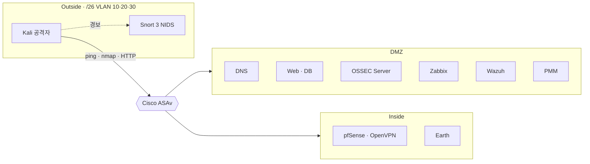

# 김가빈 · Kim Gabin

**네트워크 · 시스템 보안 엔지니어 지망생**

망을 나누고 경계를 통제하며, 탐지·관제를 직접 구축해 결과 화면으로 검증합니다. 
장애가 생기면 재설치보다 원인 범위를 좁혀 해결합니다.

---

### 🧭 지원 분야

`네트워크 보안 엔지니어` · `보안관제(SOC)` · `시스템·인프라 엔지니어`

- 🎓 영남대학교 컴퓨터학부 재학 중
- 🛡️ SKT ALEPH AI 보안·인프라 과정 (2026.08 ~ 2026.11)
- 📜 정보처리기사 취득 · 리눅스마스터 2급 준비 중

---

### 📊 결과로 확인한 것

| 지표 | 무엇을 했나 | 근거 |
| :---: | --- | --- |
| **4 / 4** | Wazuh Agent 4대 Active 연결, 24시간 이벤트 **384건** 조회 | Half-Security Labs 결과보고서 |
| **3 / 3** | 직접 쓴 Snort 3 룰로 Kali의 ping · nmap · 웹 접속 모두 경보 | Half-Security Labs 결과보고서 |
| **10 / 10** | 제로 트러스트 보안 Agent, 단계별 코드 검토 전부 통과 | [zero-trust-security-agent](https://github.com/vinn81/zero-trust-security-agent) |
| **403** | ModSecurity 룰로 `/admin` 접근과 XSS 요청 차단, 감사 로그 확인 | SKT ALEPH 실습 |
| **1 대** | SQLi → SSH → 권한 상승까지 이어지는 CTF 머신 제작·완주 검증 (팀) | SKT ALEPH CTF 과제 |

---

### 🌐 Half-Security Labs — 혼자 구축한 망

<b>재설치 없이 해결한 트러블슈팅 3건</b>

| 증상 | 원인 | 해결 |
| --- | --- | --- |
| rsyslog가 기동되지 않아 로그를 DB에 모을 수 없음 | 수업 자료의 구형 지시자 설정이 설치 버전의 모듈 선언 방식과 맞지 않음 | 설정 → 서비스 → DB 순서로 점검, 모듈 선언 방식으로 다시 써서 기동. LogAnalyzer에서 DNS 로그 확인 |
| pfSense OpenVPN 클라이언트 내보내기 인증서 오류 | OpenVPN 서버가 웹 관리용 자체 서명 인증서를 사용 | OpenVPN 전용 CA·인증서로 교체, VPN 주소 할당·터널 연결 확인 |
| Wazuh와 OSSEC 설치 충돌 | 둘 다 `/var/ossec` 경로 사용 | 덮어쓰지 않고 OSSEC Server는 별도 VM, Wazuh Agent는 서버 4대로 역할 분리 |

---

### 🛠️ Projects

| 프로젝트 | 내용 | 기술 |
| --- | --- | --- |
| 🛡️ [**zero-trust-security-agent**](https://github.com/vinn81/zero-trust-security-agent) | 제로 트러스트 보안 Agent 「헤임달」: 사용자·기기·세션 확인, 업무 앱 접근 판정, XDR 경보, 내 PC 보안 상태 실측(Windows 기본 도구와 대조) | JavaScript · PowerShell |
| 🚩 **CTF 머신 「OISecure 업무 포털」** (팀) | Ubuntu 24.04 + Apache·MariaDB·PHP. 디렉터리 열거 → UNION SQLi로 SSH 자격 증명 탈취 → sudo 파이썬 모듈 하이재킹 권한 상승. 공격 경로 외에는 Prepared Statement·CSRF·bcrypt·`Options -Indexes`·최소 권한(750/640)으로 막음 | Linux · PHP · MariaDB |
| 🌐 [**introMy**](https://github.com/vinn81/introMy) | 포트폴리오 사이트. 패스키(WebAuthn) 로그인, 서버에서 challenge·origin·서명 검증, HMAC 서명 HttpOnly 세션 | JavaScript · Vercel Functions · Neon PostgreSQL |
| 🎓 [**JOBE (진로온)**](https://github.com/vinn81/JOBE) | 종합설계 전공 진단 서비스 백엔드. 8개 도메인 · REST API, 회원가입·refresh token·이메일 인증 | Java · Spring Boot · JPA |
| ⚽ [**OS-Project**](https://github.com/vinn81/OS-Project) | Automatch: 풋살 매치 예약·자동 팀 배정 | Java · Spring Boot · JPA · MySQL |
| 🚦 [**aleph-traffic**](https://github.com/vinn81/aleph-traffic) | 달구벌 NOW: 달구벌대로 일별 통행속도 수집·비교 | Python · PostgreSQL |

---

### 🔐 Security Practice

<b>탐지 · 관제 · 방어</b>

- **IDS/IPS**: Snort 3 · Suricata 사용자 정의 룰 작성
- **HIDS / SIEM**: Wazuh Agent 연동, OSSEC 변조 탐지, Splunk 설치
- **모니터링**: Zabbix(에이전트 관제·팀 Wazuh 서버 연동), Nagios Core 소스 빌드, PMM
- **WAF**: Apache + ModSecurity `SecRule` 작성(`REQUEST_URI`, `ARGS` 검사 → 403), `modsec_audit.log` 확인
- **로그 분석**: rsyslog → LogAnalyzer, GoAccess 실시간 HTML 리포트
- **방화벽·VPN**: Cisco ASAv Inside·DMZ·Outside 분리, ACL·DACL, pfSense OpenVPN

<b>모의해킹 · CTF</b>

- **Metasploitable2**: nmap 서비스 식별 → vsftpd 2.3.4 · UnrealIRCd · Samba usermap · VNC · PostgreSQL 취약점 검증, WebDAV 업로드, SMTP VRFY 사용자 열거
- **CTF 머신 풀이**: Momentum2(쿠키 브루트포스 · Burp 업로드 우회 · 권한 상승), DoubleTrouble2, qdPM 등 9회 실습 기록
- **웹 취약점**: OWASP Juice Shop 단계별 공략, bWAPP A1~A10 정리 (SQLi · XSS · LFI/RFI · 커맨드 인젝션 · 파일 업로드)
- **위협 분석 프레임워크**: Cyber Kill Chain, MITRE ATT&CK (Caldera · Atomic Red Team 에뮬레이션 실습)

<b>네트워크 공격 원리 (학부 네트워크 보안·블록체인)</b>

SYN 플러딩 · TCP Reset · 세션 하이재킹 · Mitnick 공격 · DNS 캐시 감염 · Kaminsky 공격 · DNS 리바인딩 · 머클 트리 · 합의 알고리즘

---

### 🧰 Skills

**Network & Security**

VLAN · EIGRP/OSPF · HSRP · ACL · NAT · Site-to-Site VPN · OpenVPN · DMZ 설계

**Offensive (탐지 룰 검증용)**

**Server & OS**

DNS · HTTPS · SFTP/FTP · NFS · Samba · rsyslog · cron · 권한·umask · LVM/RAID

**Programming**

---

### 📚 학습 기록

| 분야 | 내용 |
| --- | --- |
| 전공 | 컴퓨터네트워크 · 운영체제 · 데이터베이스 · 컴퓨터 구조 · 알고리즘 · 소프트웨어 공학 · 웹프로그래밍 · 인공지능 · 컴퓨터 비전 · 데이터 분석 · IoT(라즈베리파이 GPIO · I2C · SPI · UART · MQTT) |
| 자격 | 정보처리기사 필기 노트(보안 심화 · SW 설계와 보안 · DB · 네트워크/OS), 리눅스마스터 2급 정리노트(23장) |
| 개인 공부 | Spring MVC · HTTP |

모든 수치는 결과보고서와 실측 화면에 근거합니다 · 자세한 내용은 <a href="https://intro-my-nine.vercel.app/">포트폴리오</a>

